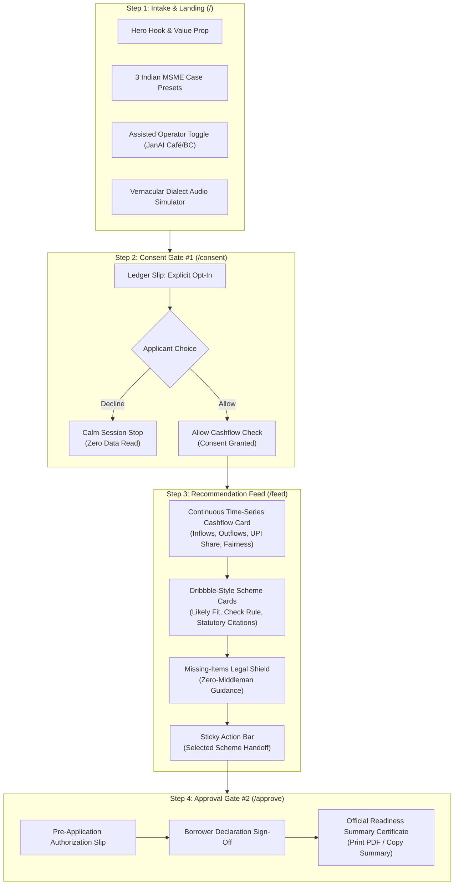

# CreditBridge 🇮🇳

> **Pre-Application Decision, Cashflow-Readiness & Rule-Cited Scheme Recommendation Layer for Indian MSMEs**  
> *Engineered for **Tech4Bharat 2026** under **Problem Statement 3.2 (Formal Credit and Schemes)** in the **MSME Finance & Compliance (`Agentic AI`)** Track.*

[](https://credit-bridge-alpha.vercel.app/)
[](https://nextjs.org)
[](https://www.typescriptlang.org)
[](https://tailwindcss.com)
[](https://tech4bharat.in)
[](https://github.com/bhargava562/creditBridge)
[](https://github.com/bhargava562/creditBridge)

🌐 **Production Web Application:** [https://credit-bridge-alpha.vercel.app/](https://credit-bridge-alpha.vercel.app/)  
📖 **Documentation:** [Architecture](docs/ARCHITECTURE.md) • [Statutory Schemes Guide](docs/SCHEMES_GUIDE.md) • [User Journey & Edge Cases](docs/USER_JOURNEY.md) • [API Reference](docs/API_REFERENCE.md)

---

## 1. Executive Summary & Why CreditBridge Exists

Viable micro-enterprises across Bharat—such as boutique tailors in Solapur, fabrication machine shops in Peenya, rural dairy chilling units in Muzaffarpur, or village SHG enterprises—generate steady daily and monthly cashflow (including verifiable UPI QR receipts). Yet they lack formal audited financial statements, multi-year ITRs, or immovable property collateral.

Even though landmark central government schemes exist—such as **PM MUDRA Yojana**, **CGTMSE**, **PMEGP**, and **Stand-Up India**, along with the unified **JanSamarth** portal—small businesses consistently miss out or apply to mismatched schemes. Incomplete files stall in bank branches for months, pushing entrepreneurs toward high-interest informal moneylenders while wasting loan processing time.

```text
+----------------------------------------------------------------------------------------------------+
|                                    THE MSME FINANCING REALITY                                      |
|                                                                                                    |
|   Steady UPI QR Receipts       ❌ NO Audited ITRs         High-Cost Informal Lenders (36-60% APR)  |
|   Healthy Operating Surplus   ---> ❌ NO Land Collateral  ---> OR Stalled Branch Applications      |
|   Viable Repayment Capacity    ❌ Mismatched Schemes      (Months lost due to small gap items)     |
+----------------------------------------------------------------------------------------------------+
                                                  │
                                                  ▼
+----------------------------------------------------------------------------------------------------+
|                                      THE CREDITBRIDGE SOLUTION                                     |
|                                                                                                    |
|   ✅ Minimal Intake + Assisted Operator Mode (JanAI Cafés, Banking Correspondents, SHG Helpers)     |
|   ✅ Explicit Consent Gate #1 (Stop cleanly if declined; zero credit bureau score hit)             |
|   ✅ Continuous Time-Series Cashflow Analysis + Algorithmic Anti-Bias Fairness Framework           |
|   ✅ Bento-to-Deck Recommendation Cards with 100% Statutory Citations (DFS, RBI, KVIC circulars)   |
|   ✅ Missing-Items & Zero-Middleman Checklist with direct free portal gateways (Udyam, DPR)         |
|   ✅ Approval Gate #2 + Printable Pre-Application Readiness Summary Certificate                   |
+----------------------------------------------------------------------------------------------------+
```

### What CreditBridge Does (and Does NOT Do)

| Feature Dimension | What CreditBridge DOES | What CreditBridge DOES NOT Do |
| :--- | :--- | :--- |
| **Loan Underwriting** | Provides **pre-application readiness** & cashflow debt-servicing velocity signals. | ❌ Does not build a bank core or promise guaranteed loan sanction. |
| **Scheme Eligibility** | Evaluates profiles using **100% deterministic statutory rules** and circular citations. | ❌ Never hallucinates eligibility with ungrounded generative LLM guesses. |
| **Data Privacy** | Enforces **two explicit consent & approval gates** (`/consent` & `/approve`). | ❌ Never reads records without consent; never sells leads to loan brokers. |
| **Middleman Protection** | Flags exact missing items with **free government links** (Udyam, KVIC). | ❌ Never charges fees or pushes users toward commission-seeking touts. |
| **Fairness & Inclusion** | Strictly forbids proxy variables (gender, caste, geography) from penalizing scores. | ❌ Never applies algorithmic redlining or collateral-bias penalties. |

---

## 2. Madman Design System: High-Craft Bento & Ledger Slips

CreditBridge moves beyond dense tax forms and intimidating trading terminals by combining:

1. **Bento-to-Deck Modular Layout:** Rounded cards, crisp borders (`#E2E6EE`), varied card weights, and clean spacing on `/` and `/feed`.
2. **Tactile Ledger & Authorization Slips:** High-focus `#0F172A` dark slate cards with `#F8FAFC` typography on `/consent` and `/approve`, complete with official status stamps (*Pending Consent*, *Approved by Owner*).
3. **Guided Stepper Rail & Persistent Case Bar:** A 4-stage workflow indicator (`01 Start` $\rightarrow$ `02 Consent` $\rightarrow$ `03 Feed & Gaps` $\rightarrow$ `04 Approval`) combined with a live enterprise context badge so users always know their evaluation state.
4. **Accessible Typography & Touch Targets:** Sized using `Plus Jakarta Sans` for humanist clarity and `JetBrains Mono` for statutory rule codes and numbers, with minimum `44px` touch targets on all interactive controls.



---

## 3. Representative Indian MSME Presets Showcase

CreditBridge includes 3 verified multi-month time-series case studies to test real decision logic:

```text
┌─────────────────────────────────────────────────────────────────────────────────────────────────┐
│ [1] Priya's Boutique & Tailoring Works (Solapur, Maharashtra)                                   │
│ • Stage: Existing (4 years) • Sector: Textiles & Boutique • Requested: ₹3,50,000                │
│ • Cashflow: Steady monthly UPI collections (~₹95K/mo), 82% QR receipts, +₹37K operating surplus │
│ • Missing Item: Udyam certificate renewal / shop address synchronization                        │
│ • Statutory Match: PM MUDRA Kishore (Likely Fit) • CGTMSE 85% Women Guarantee Coverage          │
├─────────────────────────────────────────────────────────────────────────────────────────────────┤
│ [2] Kumar Metal Fabrication & Engineering (Peenya, Bengaluru)                                   │
│ • Stage: Existing (3 years) • Sector: Light Engineering • Requested: ₹8,50,000                  │
│ • Cashflow: Growing turnover (~₹3.8L/mo), active bank current account, strong operating margin  │
│ • Missing Item: None (Udyam registered, active GST challans)                                    │
│ • Statutory Match: PM MUDRA Tarun (Likely Fit) • PMEGP Rejected (Existing unit restriction)     │
├─────────────────────────────────────────────────────────────────────────────────────────────────┤
│ [3] Aarav Dairy & Bio-Agro Farm (Muzaffarpur, Bihar)                                            │
│ • Stage: New Greenfield Venture • Sector: Agri-Allied / Dairy Chilling • Requested: ₹6,00,000   │
│ • Promoter: Scheduled Caste (SC) Rural Entrepreneur • Training: RSETI dairy certificate        │
│ • Missing Item: Detailed Project Report (DPR) with equipment supplier proforma invoices        │
│ • Statutory Match: PMEGP 35% Rural Capital Subsidy (Likely Fit) • MUDRA Kishore Start-up Line   │
└─────────────────────────────────────────────────────────────────────────────────────────────────┘
```

---

## 4. Central Government Scheme Coverage & Rule Citations

Every recommendation on CreditBridge is backed by verified central statutory circulars:

| Scheme Name | Ticket Size | Collateral Status | Key Benefit | Statutory Authority & Circular Reference |
| :--- | :--- | :--- | :--- | :--- |
| **PM MUDRA (Shishu)** | Up to ₹50,000 | 100% Collateral-Free | Zero processing fee, 100% CGFMU guarantee | Department of Financial Services (DFS) PMMY Guidelines Clause 3.1 |
| **PM MUDRA (Kishore)** | ₹50,001 to ₹5,00,000 | 100% Collateral-Free | Equipment & working capital, priority for women | PMMY Tier-II Norms / RBI Master Circular FIDD.MSME.BC.No.3 |
| **PM MUDRA (Tarun)** | ₹5,00,001 to ₹10,00,000 | 100% Collateral-Free | Scaling credit (Tarun Plus up to ₹20L) | DFS/Credit/PMMY/Vol-IV & Union Budget 2024-25 Notification |
| **CGTMSE Guarantee** | Up to ₹5,00,00,000 | 100% Collateral-Free | 85% default guarantee for micro & women units | Ministry of MSME / CGTMSE Circular No. 68/2023-24 |
| **PMEGP (KVIC)** | Up to ₹50,00,000 | 100% Collateral-Free | **15% to 35% non-refundable capital subsidy** | KVIC PMEGP Policy Circular 2022-23/Cir-12 (Greenfield Only) |
| **Stand-Up India** | ₹10 Lakhs to ₹1 Crore | 100% Collateral-Free | Mandated composite loan for SC/ST & Women | DFS Directive F.No. 28/01/2016-CP-SUIS |

---

## 5. End-to-End System Architecture

```text
creditbridge/
├── app/
│   ├── layout.tsx              # Shell, Google fonts, banner, CaseStepperBar, print rules
│   ├── globals.css             # Tailwind v4 tokens, animations, reduced-motion guards
│   ├── page.tsx                # Step 1: Landing + Quick-Start Bento Intake
│   ├── consent/
│   │   └── page.tsx            # Step 2: Consent Gate #1 (Tactile Ledger Slip)
│   ├── feed/
│   │   └── page.tsx            # Step 3: Recommendation Feed & Readiness Bento
│   ├── approve/
│   │   └── page.tsx            # Step 4: Approval Gate #2 (Authorization Slip)
│   └── api/
│       └── evaluate/
│           └── route.ts        # Validates consent, runs cashflow math & matcher engine
├── components/
│   ├── CaseStepperBar.tsx      # 4-stage progress rail + persistent case bar
│   ├── IntakePanel.tsx         # Hero hook, 3 presets, assisted toggle, dialect helper
│   ├── ConsentCard.tsx         # Ledger slip: plain-language consent & binary decision
│   ├── CashflowCard.tsx        # 6-month time-series visual, UPI mix, fairness note
│   ├── SchemeCard.tsx          # Dribbble card with expandable statutory citations drawer
│   ├── MissingItemsCard.tsx    # Zero-middleman checklist + free government links
│   └── ApprovalCard.tsx        # Authorization slip, borrower declaration & printable cert
├── lib/
│   ├── types.ts                # Strict TypeScript interfaces
│   ├── schemes.ts              # Statutory scheme rules and citations database
│   ├── cashflow.ts             # Time-series trend velocity & anti-bias math
│   └── matcher.ts              # Deterministic qualification & gap detection engine
├── data/
│   └── sampleProfiles.json     # 3 realistic Indian MSME time-series profiles
├── docs/
│   ├── ARCHITECTURE.md         # Deep technical design & two-gate state machine
│   ├── SCHEMES_GUIDE.md        # Statutory circular breakdown & JanSamarth mapping
│   ├── USER_JOURNEY.md         # Self-service & assisted operator walkthrough
│   └── API_REFERENCE.md        # Complete /api/evaluate endpoint schema documentation
├── scripts/
│   ├── test-engine.ts          # 13 deterministic rule & time-series tests
│   └── test-api.ts             # 10 API route & consent gate tests
├── package.json
├── tsconfig.json
└── README.md
```

---

## 6. Live Deployment & Local Setup

### Live Production Deployment
* 🌐 **Production Web Application:** [https://credit-bridge-alpha.vercel.app/](https://credit-bridge-alpha.vercel.app/)

### Local Prerequisites
* **Node.js:** v18.17.0 or higher
* **Package Manager:** npm or yarn

### Installation Steps

```bash
# 1. Clone the repository
git clone https://github.com/bhargava562/creditBridge.git
cd creditBridge

# 2. Install dependencies
npm install

# 3. Start development server
npm run dev
```

Open [http://localhost:3000](http://localhost:3000) in your browser.

---

## 7. Automated Test Suite & Verification

CreditBridge includes comprehensive automated test scripts validating cashflow velocity calculations, deterministic scheme qualification, statutory citations, and consent security boundaries.

```bash
# Run deterministic rule engine tests (13 test cases)
npx --yes tsx scripts/test-engine.ts

# Run API route & consent gate tests (10 test cases)
npx --yes tsx scripts/test-api.ts
```

### Test Coverage Summary:
* ✅ **13/13 Engine Tests Passing:** Profile inflow math, UPI concentration verification, MUDRA tier boundaries, PMEGP greenfield restrictions, DPR requirements, and 100% statutory citations coverage.
* ✅ **10/10 API Tests Passing:** 403 Forbidden on declined consent, 400 Bad Request on invalid inputs, 200 OK on consented evaluations with full audit metadata.

---

## 8. Alignment with Tech4Bharat 2026 Evaluation Criteria

| Evaluation Dimension | How CreditBridge Delivers |
| :--- | :--- |
| **Problem Impact (3.2)** | Addresses the root cause of small business credit exclusion: pre-application mismatch and documentation friction. |
| **Agentic AI & Determinism** | Replaces ungrounded LLM hallucinations with strict, deterministic statutory rules backed by verified government circulars. |
| **Algorithmic Fairness** | Strictly forbids proxy variables (gender, caste, geography) from penalizing credit readiness; uses them solely to unlock higher affirmative subsidies. |
| **Assisted Operator Support** | Enables rural JanAI Cafés, Banking Correspondents, and SHG animators to assist low-literacy borrowers without stripping borrower autonomy. |
| **Privacy & Consent** | Enforces two explicit consent/approval gates. Zero unconsented data reads; zero lead trading. |

---

## 9. License & Team

Developed with ❤️ for **Tech4Bharat 2026** by Bhargava and Team.  
Distributed under the **MIT License**.
