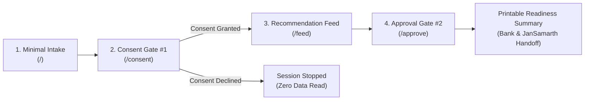

# CreditBridge 🇮🇳

> **Pre-Application Decision, Cashflow-Readiness & Rule-Cited Scheme Recommendation Layer for Indian MSMEs**  
> *Built for **Tech4Bharat 2026** under **Problem Statement 3.2 (Formal Credit and Schemes)** in the **MSME Finance & Compliance (`Agentic AI`)** Track.*

[](https://nextjs.org)
[](https://www.typescriptlang.org)
[](https://tailwindcss.com)
[](https://tech4bharat.in)
[](https://github.com/bhargava562/creditBridge)
[](https://github.com/bhargava562/creditBridge)

---

## 1. Why CreditBridge Exists

Viable micro-enterprises across Bharat—such as boutique tailors in Solapur, fabrication machine shops in Peenya, rural dairy chilling units in Muzaffarpur, or village SHG enterprises—generate steady daily and monthly cashflow (including verifiable UPI QR receipts). Yet they lack formal audited financial statements, multi-year ITRs, or immovable property collateral.

Even though landmark central government schemes exist—such as **PM MUDRA Yojana**, **CGTMSE**, **PMEGP**, and **Stand-Up India**, along with the unified **JanSamarth** portal—small businesses consistently miss out or apply to mismatched schemes. Incomplete files stall in bank branches for months, pushing entrepreneurs toward high-interest informal moneylenders while wasting loan processing time.

### What CreditBridge Does (and Does Not Do)

* ❌ **CreditBridge does NOT** build a bank core, replace JanSamarth, or promise guaranteed loan sanction.
* ✅ **CreditBridge DOES** sit **on top** of existing scheme rules and consented financial records as an intelligent, single-root pre-application layer:
  1. **Minimal Intake + Assisted Mode:** Starts with a few essential inputs rather than an exhausting form, with dedicated support for assisted operators (JanAI Cafés, Banking Correspondents, SHG Sahayaks).
  2. **Explicit Consent Gate #1:** Demands clear authorization before inspecting any cashflow records; halts cleanly if declined.
  3. **Continuous Time-Series Cashflow + Anti-Bias Audit:** Analyzes continuous multi-month velocity, net operating surplus, and UPI concentration into plain-language signals and objective debt capacity without algorithmic redlining.
  4. **Feed-Style Scheme Recommendations with Statutory Citations:** Delivers scannable scheme cards with explicit Department of Financial Services (DFS), RBI, and KVIC circular citations, and flags wrong-stage schemes early.
  5. **Missing-Items & Zero-Middleman Checklist:** Displays only verified missing items (such as Udyam registration or project DPR) with step-by-step guidance on how to resolve them 100% free without paying touts.
  6. **Approval Gate #2:** Enforces explicit entrepreneur sign-off before generating the final printable and copyable Pre-Application Readiness Summary certificate.

---

## 2. System Architecture

```text
+-----------------------------------------------------------------------------------+
|                                CLIENT (Next.js UI)                                |
|                                                                                   |
|  [ / Intake ]       ---> [ /consent Gate #1 ]     ---> [ /feed Recommendation ]   |
|       |                         |                              |                  |
|       v                         v                              v                  |
|  • Minimal inputs          • Plain-language               • 6-Month Time-Series   |
|  • 3 Realistic Presets       explanation                  • Plain-language signals|
|  • Assisted Operator Mode  • Binary: Allow vs Stop        • Scheme Cards + Badges |
|  • Voice Query Simulator   • Zero unconsented read        • Statutory Citations   |
|                                                           • Missing-Item Gaps     |
|                                                                    |              |
|                                                                    v              |
|                                                        [ /approve Gate #2 ]       |
|                                                        • Borrower Declaration     |
|                                                        • Official Readiness Cert  |
|                                                        • Print / Copy Summary     |
+--------------------------------------------------------------------+--------------+
                                     | POST /api/evaluate
                                     v
+-----------------------------------------------------------------------------------+
|                           SERVER (Next.js App Route Handler)                      |
|                                                                                   |
|  app/api/evaluate/route.ts                                                        |
|  ├── Validates schema & enforces consentGranted === true                          |
|  ├── lib/cashflow.ts  --> Computes trend velocity, surplus, UPI share, & fairness |
|  ├── lib/matcher.ts   --> Deterministic statutory rule engine & gap detection     |
|  └── lib/schemes.ts   --> PMMY (4 tiers), CGTMSE, PMEGP, Stand-Up India database  |
+-----------------------------------------------------------------------------------+
```

---

## 3. The 4-Step User Journey



### Step 1: Minimal Intake (`/`)
* **3 Ready-to-Test Scenarios:**
  1. **Priya's Boutique & Tailoring Works (Solapur):** Existing women-owned micro-unit (4 yrs), ₹3.5L request for computerized embroidery machines, 82% UPI QR receipts, missing Udyam certificate.
  2. **Kumar Metal Fabrication & Engineering (Bengaluru):** Existing manufacturing unit (3 yrs), ₹8.5L request for fiber laser cutter, active current account, Udyam registered.
  3. **Aarav Dairy & Bio-Agro Farm (Muzaffarpur):** New rural venture, SC promoter, ₹6.0L request, eligible for 35% PMEGP rural subsidy.
* **Assisted Operator Mode:** Toggle for JanAI Cafés, Banking Correspondents (BCs), or SHG Bank Sakhis to record ground notes while keeping final sign-off with the entrepreneur.
* **Simulated Voice Dialect Assistant:** One-click spoken vernacular queries (Hindi, Marathi, Kannada, Bhojpuri) demonstrating accessibility for low-literacy borrowers.

### Step 2: Explicit Consent Gate #1 (`/consent`)
* Plain-language transparency on what will be inspected (inflow velocity, UPI receipt frequency, debt service buffer) and strict guarantees (no credit bureau hit, no broker lead selling).
* Binary choice: **"Allow & Analyze Cashflow"** vs **"Decline & Stop Session"**.
* If declined, cashflow analysis stops immediately with zero transaction records saved or transmitted.

### Step 3: Recommendation Feed & Cashflow Gaps (`/feed`)
* **Continuous Cashflow Visualizer:** 6-month continuous inflow/outflow bar visualization, consistency score (0–100), UPI concentration share, and plain-language signals.
* **Feed Cards with Source Citations:** Filtered into *Likely Fit*, *Check Rule*, and *Not a Fit*. Includes expandable drawers citing exact Department of Financial Services (DFS), RBI, and KVIC circular clauses with direct links to official portals.
* **Missing Items Checklist:** Shows only genuine gaps (e.g., Udyam registration, DPR requirement) with direct links to free government portals and zero-middleman instructions.

### Step 4: Approval Gate #2 & Final Readiness Summary (`/approve`)
* **Borrower Declaration:** Applicant must check the authorization declaration box before generating the summary document.
* **Official Pre-Application Readiness Summary:** High-trust, printable (`@media print` formatted) and copyable certificate designed for presentation to a bank branch manager or JanSamarth portal.

---

## 4. Central Government Scheme Coverage

| Scheme | Category / Limit | Collateral Status | Key Highlight | Official Circular Citation |
| :--- | :--- | :--- | :--- | :--- |
| **PM MUDRA (Shishu)** | Up to ₹50,000 | 100% Collateral-Free | Zero processing fee, 100% CGFMU guarantee | DFS PMMY Master Guidelines Clause 3.1 |
| **PM MUDRA (Kishore)** | ₹50,001 to ₹5,00,000 | 100% Collateral-Free | Equipment & working capital, women priority | PMMY Tier-II Norms / RBI MSME Master Dir |
| **PM MUDRA (Tarun)** | ₹5,00,001 to ₹10,00,000 | 100% Collateral-Free | Scaling credit (Tarun Plus up to ₹20L) | DFS/Credit/PMMY/Vol-IV & Budget 2024-25 |
| **CGTMSE Guarantee** | Up to ₹5,00,00,000 | 100% Collateral-Free | 85% default guarantee for micro & women units | CGTMSE Circular No. 68/2023-24 |
| **PMEGP (KVIC)** | Up to ₹50,00,000 | 100% Collateral-Free | **15% to 35% non-refundable capital subsidy** | KVIC PMEGP Policy Circular 2022-23/Cir-12 |
| **Stand-Up India** | ₹10 Lakhs to ₹1 Crore | 100% Collateral-Free | Mandated SC/ST & Women founder credit | DFS Notification F.No. 28/01/2016-CP-SUIS |

---

## 5. Repository Structure

```text
creditbridge/
├── app/
│   ├── layout.tsx              # Global shell, banner, accessibility, print styling
│   ├── globals.css             # Tailwind CSS setup + reduced-motion support
│   ├── page.tsx                # Step 1: Minimal intake & preset showcase
│   ├── consent/
│   │   └── page.tsx            # Step 2: Explicit Consent Gate #1
│   ├── feed/
│   │   └── page.tsx            # Step 3: Recommendation feed & cashflow card
│   ├── approve/
│   │   └── page.tsx            # Step 4: Approval Gate #2 & Readiness Summary
│   └── api/
│       └── evaluate/
│           └── route.ts        # Validates consent, runs deterministic engine
├── components/
│   ├── IntakePanel.tsx         # Inputs, preset cards, assisted operator mode
│   ├── ConsentCard.tsx         # Plain-language consent & binary decision
│   ├── CashflowCard.tsx        # 6-month time-series chart & fairness audit
│   ├── SchemeCard.tsx          # Feed card with statutory citations drawer
│   ├── MissingItemsCard.tsx    # Actionable gaps + free portal links
│   └── ApprovalCard.tsx        # Sign-off declaration & printable certificate
├── lib/
│   ├── types.ts                # TypeScript interfaces
│   ├── schemes.ts              # Statutory scheme rules and citations database
│   ├── cashflow.ts             # Time-series trend & anti-bias math
│   └── matcher.ts              # Deterministic qualification & gap engine
├── data/
│   └── sampleProfiles.json     # 3 Indian MSME time-series profiles
├── docs/
│   ├── ARCHITECTURE.md         # Deep technical & state machine documentation
│   ├── SCHEMES_GUIDE.md        # Statutory circular breakdown & JanSamarth mapping
│   ├── USER_JOURNEY.md         # Self-service & assisted operator walkthrough
│   └── API_REFERENCE.md        # Complete /api/evaluate endpoint documentation
├── scripts/
│   ├── test-engine.ts          # 13 deterministic rule & time-series tests
│   └── test-api.ts             # 10 API route & consent gate tests
├── package.json
├── tsconfig.json
└── README.md
```

---

## 6. Quickstart & Local Setup

### Prerequisites
* **Node.js:** v18.17.0 or higher
* **Package Manager:** npm or yarn

### Installation Steps

```bash
# 1. Clone repository
git clone https://github.com/bhargava562/creditBridge.git
cd creditBridge

# 2. Install dependencies
npm install

# 3. Run development server
npm run dev
```

Open [http://localhost:3000](http://localhost:3000) in your browser to explore the CreditBridge workflow.

### Building for Production

```bash
npm run build
npm start
```

---

## 7. Automated Test Suite

CreditBridge includes comprehensive automated test scripts validating cashflow velocity calculations, deterministic scheme qualification, statutory citations, and consent security boundaries.

```bash
# Run deterministic rule engine tests (13 test cases)
npx tsx scripts/test-engine.ts

# Run API route & consent gate tests (10 test cases)
npx tsx scripts/test-api.ts
```

### Test Coverage Summary:
* ✅ **13/13 Engine Tests Passing:** Profile inflow math, UPI concentration verification, MUDRA tier assignment, PMEGP greenfield restrictions, DPR requirements, and 100% statutory citations coverage.
* ✅ **10/10 API Tests Passing:** 403 Forbidden on declined consent, 400 Bad Request on invalid inputs, 200 OK on consented evaluations with full audit metadata.

---

## 8. Alignment with Tech4Bharat 2026 Evaluation Criteria

| Evaluation Dimension | How CreditBridge Delivers |
| :--- | :--- |
| **Problem Impact (3.2)** | Tackles the root cause of MSME rejection: mismatch with scheme rules and lack of pre-application readiness. |
| **Agentic AI & Determinism** | Replaces ungrounded LLM hallucinations with strict, deterministic statutory rules backed by verified government circulars. |
| **Fairness & Inclusion** | Strictly forbids proxy variables (gender, caste, geography) from penalizing credit readiness; uses them solely to unlock higher affirmative subsidies. |
| **Assisted Operator Support** | Enables rural JanAI Cafés, Banking Correspondents, and SHG animators to assist low-literacy borrowers without stripping borrower autonomy. |
| **Privacy & Consent** | Enforces two explicit consent/approval gates. Zero unconsented data reads; zero lead trading. |

---

## 9. License & Team

Developed with ❤️ for **Tech4Bharat 2026** by Bhargava and Team.  
Distributed under the **MIT License**.
