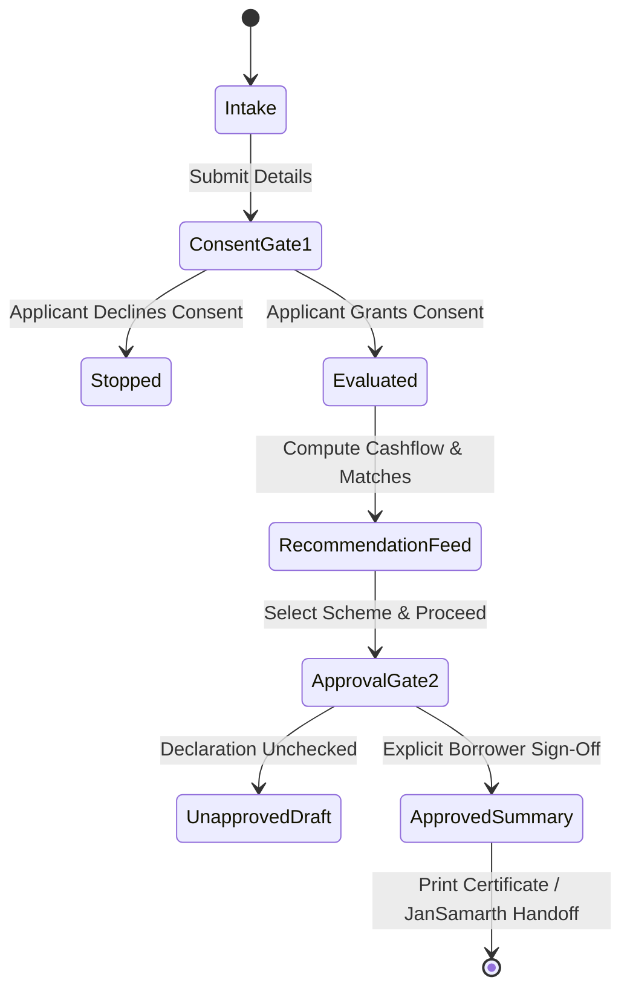

# CreditBridge — Architecture & Technical Design

## 1. Executive Summary

**CreditBridge** is a deterministic pre-application decision, cashflow-readiness, and rule-cited scheme recommendation layer designed for **Tech4Bharat 2026** under **Problem Statement 3.2 (Formal Credit and Schemes)** in the **MSME Finance & Compliance (`Agentic AI`)** track.

It solves the fundamental barrier preventing viable Indian micro-enterprises (tailors, fabricators, dairy farms, kirana stores) from securing formal credit: **the pre-application mismatch and documentation gap**. Viable micro-enterprises generate healthy daily and monthly cashflow (including verifiable UPI QR receipts) but lack formal audited financials, 3-year ITRs, or immovable property collateral.

Rather than building a bank core or hallucinating loan approvals, CreditBridge acts as an **intelligent, rule-grounded pre-application gatekeeper** that ensures entrepreneurs apply only to statutory schemes for which they qualify, with clear source citations, transparent cashflow velocity signals, and an unshakeable two-gate consent/approval architecture.

---

## 2. System Architecture & Component Topology

CreditBridge is built on **Next.js (App Router)** utilizing TypeScript and Tailwind CSS.

```text
+---------------------------------------------------------------------------------+
|                               CLIENT LAYER                                      |
|                                                                                 |
|  [ Step 1: / ]            [ Step 2: /consent ]          [ Step 3: /feed ]       |
|  IntakePanel              ConsentCard                   CashflowCard            |
|  - Minimal inputs         - Explicit Consent Gate #1    - Time-series visual    |
|  - Preset selector        - Binary: Allow or Stop       - Plain signals         |
|  - Assisted operator      - Zero unconsented read       - Fairness check note   |
|  - Voice query helper                                   SchemeCard (Feed)       |
|                                                         - Status badges         |
|                                                         - Statutory citations   |
|                                                         - Why/why-not rationale |
|                                                         MissingItemsCard        |
|                                                         - Zero-middleman fixes  |
|                                                                 |               |
|                                                                 v               |
|                                                     [ Step 4: /approve ]        |
|                                                     ApprovalCard                |
|                                                     - Approval Gate #2          |
|                                                     - Borrower sign-off         |
|                                                     - Printable Readiness Cert  |
+-----------------------------------------------------------------+---------------+
                                  |
                                  | POST /api/evaluate
                                  v
+---------------------------------------------------------------------------------+
|                               SERVER LAYER                                      |
|                                                                                 |
|  app/api/evaluate/route.ts                                                      |
|  ├── 1. Validates input schema and checks explicit consentGranted === true      |
|  ├── 2. Calls lib/cashflow.ts (Continuous time-series velocity math)            |
|  ├── 3. Calls lib/matcher.ts (Deterministic statutory scheme rules)             |
|  └── 4. Returns structured EvaluationResponse with disclaimer & audit metadata  |
+---------------------------------------------------------------------------------+
                                  |
                                  +-----------------------+
                                  |                       |
                                  v                       v
                    +-----------------------+   +-------------------+
                    | lib/schemes.ts        |   | lib/cashflow.ts   |
                    | Statutory database:   |   | - Inflow trend    |
                    | - PM MUDRA (4 tiers)  |   | - Surplus math    |
                    | - CGTMSE (85% cover)  |   | - UPI consistency |
                    | - PMEGP (35% subsidy) |   | - EMI buffer      |
                    | - Stand-Up India      |   | - Fairness audit  |
                    +-----------------------+   +-------------------+
```

---

## 3. Core Architectural Principles & Guardrails

### 3.1. Deterministic Rule Matching Over Generative Hallucination
* **Zero Generative Guesswork for Eligibility:** Scheme qualification, tier assignments, and subsidy calculations execute via deterministic TypeScript logic in `lib/matcher.ts` and `lib/schemes.ts`.
* **Explicit Statutory Citations:** Every recommendation card carries citations from the Department of Financial Services (DFS), Reserve Bank of India (RBI), Ministry of MSME, or KVIC, including circular numbers and official portal links.
* **Negative Fit Explanations:** When a scheme is mismatched (e.g. applying for PMEGP for an existing shop, or requesting ₹8 Lakhs under MUDRA Kishore), CreditBridge flags the exact statutory clause preventing fit, rather than failing silently.

### 3.2. Two-Gate Consent & Approval State Machine



1. **Explicit Consent Gate #1 (`/consent`):**
   * Preconditions: Applicant details entered or preset loaded.
   * Action: Explains exactly what is read (cashflow turnover frequency, digital receipts) and what is protected (zero bureau hit, zero broker lead selling).
   * Decline Path: If applicant clicks "Decline & Stop Session", cashflow analysis is aborted immediately. Returns HTTP 403 `CONSENT_DENIED` at the API layer.
2. **Approval Gate #2 (`/approve`):**
   * Preconditions: Scheme feed and missing gaps reviewed.
   * Action: Requires applicant sign-off declaration checkbox before generating the official Pre-Application Readiness Summary. Prevents unauthorized operator submission.

### 3.3. Continuous Time-Series Cashflow Math

Rather than relying on single-month snapshots or self-reported turnover, CreditBridge computes continuous time-series metrics over historical cycles:
* **Average Monthly Inflow & Outflow:** Arithmetic mean of verified transaction velocity.
* **Operating Surplus:** $\text{Average Inflow} - \text{Average Outflow}$.
* **Inflow Trajectory:** Compares first-half and second-half windows; detects growth ($\ge +10\%$), contraction ($\le -10\%$), or stability.
* **Consistency Score ($0-100$):** Combines coefficient of variation ($\sigma / \mu$), consecutive non-negative cashflow months, and UPI transaction frequency.
* **Conservative EMI Servicing Buffer:** Calculated as $45\%$ of free surplus after accounting for existing monthly debt obligations.

### 3.4. Algorithmic Fairness & Anti-Bias Framework
CreditBridge implements strict algorithmic neutrality:
* **Prohibited Negative Proxies:** Geographical PIN-code redlining, gender, caste, religion, or lack of immovable property are **strictly prohibited** from penalizing the cashflow velocity score.
* **Affirmative Use Only:** Demographic identifiers (women-owned, SC/ST founder, rural/aspirational geography) are utilized **exclusively in an affirmative manner** to unlock higher government capital subsidies (e.g., $35\%$ rural PMEGP subsidy vs $15\%$ general urban) and concessional guarantee fees under CGTMSE.

---

## 4. Data Flow & Security Model

* **Client Storage:** Active profile and evaluation responses are held in `sessionStorage`, ensuring ephemeral data scoping that clears automatically when the browser session terminates.
* **Minimal Data Exposure:** Raw transaction arrays remain encapsulated within the active session; only abstracted plain-language signals and summary metrics appear on the feed.
* **Transparent Prototype Labeling:** All responses, UI screens, and generated certificates carry persistent metadata indicating demo status with statutory citations.
